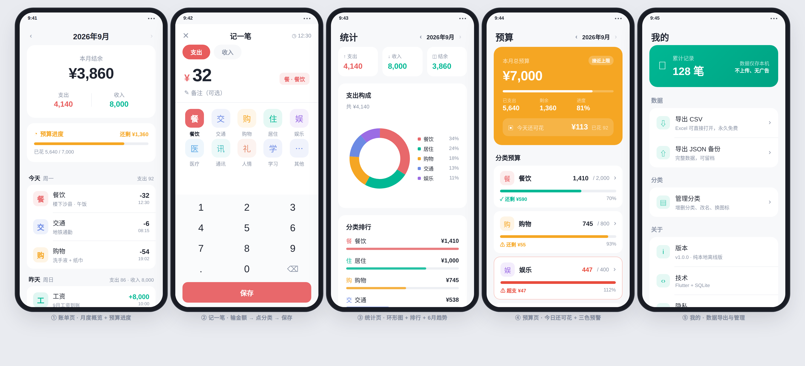

# 记账 v1.2.0

一个**纯本地离线**的安卓记账 App。预算管控版，界面清爽浅色，记完立刻看到预算进度。

**Flutter 3.0 · Android 7.0+ · 无网络权限 · 无广告无账号**



> **v1.2.0 更新**：**总预算现在可以自己设了**（以前是各分类额度自动相加，设不了）。
> 分类预算改成**按需添加** —— 只显示你真正在管的分类，不再把十个分类全铺出来。
>
> **v1.1.1 改进**：支付感应**真正即时** —— 付款或到账的**瞬间**确认框直接弹到屏幕上，
> 不再需要先打开 App。
>
> **v1.1.0 新增**：**支付自动感应** —— 支付宝 / 微信付款或收款时，App 自动弹出确认框，
> 金额、分类、备注都已预填好，你点一下「保存」就记完了。
>
> **v1.0.2 更新**：记完一笔后，账单 / 统计 / 预算 / 我的四个页面**全部自动刷新**。
>
> **v1.0.1 修复**：v1.0.0 安装后闪退，原因是 Android 工程漏配 Kotlin 编译插件。
> 详见文末「版本记录」。

---

## 从源码构建

```bash
flutter pub get
flutter build apk --release --no-tree-shake-icons
# 产物：build/app/outputs/flutter-apk/app-release.apk
```

需要 **Flutter 3.0** 和 **JDK 17**（JDK 20+ 会报 `Unsupported class file major version 64`）。

> **为什么必须带 `--no-tree-shake-icons`？**
> 分类图标存在数据库里，代码中通过 `IconData(codePoint, ...)` 动态构造（见 `lib/models/models.dart`）。
> 编译期无法推断用到哪些图标，图标树摇会报错或漏字形。加这个参数直接打包完整字体（多约 1.4MB），最稳妥。

国内网络构建时加上镜像环境变量：

```bash
export PUB_HOSTED_URL=https://pub.flutter-io.cn
export FLUTTER_STORAGE_BASE_URL=https://storage.flutter-io.cn
```

---

## 一、安装到手机

1. 到 [Releases](https://github.com/song0910song/record-ledger/releases/latest) 下载 `record-ledger-v1.2.0.apk`，传到手机（微信文件传输 / QQ / 数据线均可）
2. 手机上点开这个 apk 文件
3. 系统会提示「禁止安装未知来源应用」→ 点**设置** → 允许来自此来源
4. 继续安装 → 桌面出现绿色图标「记账」

> 支持 Android 7.0 及以上（minSdk 24）。  
> 已内置 arm64-v8a / armeabi-v7a / x86_64 三种架构，绝大多数手机都是 arm64，直接装即可。

**从旧版升级**：直接安装即可覆盖，**数据会保留**（包名和签名都没变）。
若系统提示签名冲突，先卸载旧版再装 —— 但那样会清空数据，建议先「我的 → 导出 CSV」备份。

**为什么会被拦截？** 因为这个 APK 是**自签名**的（不是从应用商店下载的）。自用完全没问题，签名只是为了系统能识别应用身份。

---

## 二、30 秒上手

```
打开 App
  ↓
点底部中间的大绿加号「+」
  ↓
输金额（自带数字键盘，不用调系统输入法）
  ↓
点一个分类（比如"餐饮"）
  ↓
点「保存」
  ↓
回到首页 —— 顶部立刻能看到本月预算进度条
```

**核心循环就这一个**：记一笔 → 立刻看到还剩多少 → 心里有数。

---

## 三、四个页面分别干什么

| 页面     | 作用       | 关键信息                           |
| ------ | -------- | ------------------------------ |
| **账单** | 看这个月花了多少 | 本月结余大数字 + **预算进度条** + 按日分组的流水  |
| **统计** | 钱花在哪了    | 三个克制视图：支出环形图 / 分类排行 / 近 6 月柱状图 |
| **预算** | 事前规划     | **总预算** + 按需设置的分类额度 + **今天还可花多少钱** |
| **我的** | 数据管理     | 导出 CSV/JSON、管理分类、支付感应设置、清空数据   |

### 预算进度条的颜色规则

这是整个 App 的核心设计，一眼就能判断状态：

| 颜色             | 条件        | 含义       |
| -------------- | --------- | -------- |
| 🟢 绿 `#00B894` | 已花 < 80%  | 健康，放心花   |
| 🟠 橙 `#F5A623` | 已花 ≥ 80%  | 接近上限，收着点 |
| 🔴 红 `#E84C3D` | 已花 > 100% | 超支了      |

预算页顶部还有一句「**今天还可花 ¥113**」，算法是：

```
今日可用额度 =（总预算 - 当月已花）/ 本月剩余天数
```

把月度预算拆成每天能花的钱，比一个笼统的总数更有约束力。

---

## 四、预算怎么用

预算分两层，**互不干扰，各管一段**：

### 总预算 —— 管整体

点击预算页顶部的彩色卡片就能设，比如「这个月最多花 7000」。

- **按月独立**：9 月设了 7000，10 月不设就自动沿用 7000
- 界面上会标出「沿用自 2026年8月」，数字从哪来的看得清
- 想给某个月单独设不同额度，切到那个月改一下就行

> 关于「沿用」的规则：只**往前找**最近一次设置。
> 给 12 月设了额度不会穿越回来影响 9 月 —— 否则你为年底设的数会莫名改掉当月预算。

### 分类预算 —— 管细节

**只显示你设过额度的分类**，没设的不占地方。

比如你只想管住「餐饮」和「购物」，那列表里就只有这两条，剩下八个分类不会铺在屏幕上。
想给新分类设额度，点底部「**+ 添加分类预算**」，弹出分类选择器。

> **为什么要这么改？** 之前的版本把十个支出分类全列出来，每个都写着"设置额度"。
> 看着满屏待办事项，反而不知道从哪下手，最后干脆一个都不设。
> 现在只列你在管的，加的时候主动选 —— 决策成本低得多。

### 两层预算的关系

**完全独立**：总预算是总预算，分类额度是分类额度，两者不互相约束。

给分类设额度时，如果累计超过总预算，只会在标题旁边提示「已分配 8,200 / 7,000」，**但不阻止保存**。

理由是：分类额度更像「意图分配」，月初拍脑袋分出来的数字经常要调。硬拦着只会让人放弃设分类预算，反而失去意义。总预算才是真正的闸门。

### 首页的进度条用哪个口径？

**总预算 vs 当月全部支出** —— 不是「只有设了额度的分类」。

这点很关键：如果你只给「餐饮」设了额度，那买衣服花的钱也必须计入进度条。
否则进度条会一直显得很宽松，等你发现的时候已经严重超支了。

---

## 五、支付自动感应

支付宝 / 微信付完款，通知栏弹出「支付成功 ¥28.50」的**那一刻**，确认框就弹到你面前 ——
不用你打开记账 App，不用输金额。

### 弹出方式（v1.1.1 核心改进）

通知到达时，App 按三级策略把确认框送到你面前：

```
支付宝/微信付款通知到达
  ↓
① App 正在前台？
   是 → 直接弹确认框
  ↓ 否
② 有「悬浮窗权限」？
   是 → 付款瞬间，确认框直接弹到屏幕上（不用你找 App）
  ↓ 否
③ 发一条高优先级横幅通知 → 点一下横幅，直达确认框
  ↓ （连横幅权限都没有）
  通知暂存，下次打开 App 自动补弹
```

**想要 ② 的效果（推荐）**：App 里「我的 → 支付自动记账 → 弹出方式 → 开启悬浮窗权限」。
这是 Android 的系统机制 —— 10.0 之后系统禁止后台 App 自行弹出界面，
但**持有悬浮窗权限的应用会被豁免**。你只需要开一次。

| 手机 | 悬浮窗权限路径 |
|---|---|
| 原生 Android | 设置 → 应用 → 特殊应用权限 → 显示在其他应用上层 |
| 小米 / Redmi | 设置 → 应用管理 → 记账 → 权限管理 → 显示悬浮窗；**另需打开「后台弹出界面」** |
| 华为 / 荣耀 | 设置 → 应用 → 应用管理 → 记账 → 权限 → 悬浮窗 |
| OPPO / 一加 | 设置 → 应用管理 → 记账 → 权限管理 → 悬浮窗 |
| vivo / iQOO | 设置 → 应用管理 → 记账 → 权限 → 悬浮窗 |

> **小米/红米特别注意**：MIUI 把「后台弹出界面」做成了独立权限，
> 光开悬浮窗不够，两个都要开，并建议允许「自启动」。

### 效果长这样

```
你扫码付了 28.5 元买奶茶
  ↓
支付宝弹出通知："支付成功 ¥28.50"
  ↓（同一秒）
记账确认框直接弹到屏幕上：
  ┌──────────────────────────────┐
  │  检测到一笔支出                │
  │  ¥ 28.50                      │
  │  分类：餐饮  [可改]            │
  │  备注：支付成功 ¥28.50         │
  │  来源：支付宝                  │
  │  ────────────────────────────  │
  │   [ 忽略 ]      [ 保存 ]       │
  └──────────────────────────────┘
  ↓
点「保存」→ 记完了，账单页立刻更新
```

**它不会偷偷记账** —— 每一笔都要你点确认。识别错了就点「忽略」。

### 怎么开启

这是 Android 的系统级权限，**必须你手动开一次**，任何 App 都无法用代码申请：

> **设置 → 应用 → 特殊应用权限 → 通知使用权 → 找到「记账」→ 打开**

不同手机路径略有差异，几个常见 ROM：

| 手机 | 路径 |
|---|---|
| 原生 Android | 设置 → 应用 → 特殊应用权限 → 通知使用权 |
| 小米 / Redmi | 设置 → 应用设置 → 应用管理 → 记账 → 通知使用权 |
| 华为 / 荣耀 | 设置 → 应用 → 应用管理 → 记账 → 通知使用权 |
| OPPO / 一加 | 设置 → 应用管理 → 记账 → 通知使用权 |
| vivo / iQOO | 设置 → 应用管理 → 记账 → 权限管理 → 通知使用权 |

**懒人做法**：打开 App →「我的」→「支付自动记账」→ 点「去开启」，
App 会直接跳到系统设置页，你只要找到「记账」打开开关就行。

### 它是怎么工作的

```
支付宝/微信发通知
      ↓
PayNotificationListener（安卓系统服务，常驻）
      ↓  只挑这两个 App 的通知，其他一律不看
      ├─ App 在前台 → MethodChannel → Flutter 弹确认框
      ├─ 有悬浮窗权限 → startActivity 把确认框拉到屏幕上
      └─ 都没有 → 发 heads-up 横幅，点击直达确认框
      ↓
PayDetectService（Dart 层调度：去重 / 分类匹配 / 排队）
      ↓
PayConfirmSheet（弹窗，预填好金额分类，等你点确认）
      ↓
你点「保存」→ 写进本地数据库
```

**几个关键设计**：

- **只监听支付宝和微信** —— 包名白名单硬编码，其他 App 的通知连读都不读
- **前后台状态同步** —— App 退到后台时 Dart 主动告诉原生层"我看不见了"，
  原生层收到通知后改走唤起/横幅路径，实现付款即弹
- **3 分钟去重** —— 同一条通知可能被系统重复推送，用「包名+金额+标题+正文」做指纹，3 分钟内只处理一次
- **缓存补发双保险** —— 通知到达时无论走哪条弹出路径，都会先存进本地缓存（最多 50 条）。
  就算唤起失败、横幅也没看到，下次打开 App 照样补弹，不会漏记
- **解析不了就保留原文** —— 实在认不出的通知，弹窗里会显示原始文案，你自己判断是不是一笔账

### 它认得出什么

**支出**（会弹确认框）：支付成功、付款、消费、扣款、转出、扣费……

**收入**（会弹确认框，方向自动识别）：收款、收到、退款、已到账、转入、红包到账……

**直接忽略**（不打扰你）：零钱通收益、余额宝收益、优惠券到账、账单已出、还款提醒、验证码、待支付、支付失败、交易关闭、已取消……

**自动猜分类**：根据商户名猜，比如「星巴克 / 麦当劳 / 美团」→ 餐饮，「滴滴 / 地铁 / 加油」→ 交通，「京东 / 淘宝」→ 购物。猜错了在弹窗里改一下就行。

### 已知限制（说在明处）

- **「立即弹出」依赖悬浮窗豁免** —— 这是 Android 提供的唯一合法通道。
  不给悬浮窗权限就降级为横幅提醒（体验也不差，就是多点一下）
- **MIUI 有额外的「后台弹出界面」权限** —— 小米/红米用户需要单独打开，
  这是 MIUI 自己的限制，App 无法代为申请
- **国产 ROM 可能杀掉后台服务** —— 需要在「电池 / 省电策略」里把「记账」设为**不受限制**，
  并允许自启动，否则息屏久了可能收不到通知
- **通知文案会变** —— 支付宝和微信随时可能改文案格式，解析规则在 `lib/services/pay_parser.dart` 里集中维护，改一个文件就行
- **不是 100% 准确** —— 有些通知（比如「您有一笔待支付订单」）语义模糊，所以设计成**必须你确认**，而不是自动记账
- **只有支付宝和微信** —— 云闪付、银行 App 的通知暂不支持

### 关掉它

「我的」→「支付自动记账」→ 关掉总开关。
彻底不想要的话，去系统设置里关掉「通知使用权」即可 —— 关掉后 App 完全收不到任何通知。

---

## 六、数据安全

- **无网络权限** —— 代码里根本没申请 `INTERNET` 权限，想上传也上传不了
- **无广告、无账号、无登录**
- 所有数据存在手机本地的 SQLite 数据库里
- 换手机时：用「我的 → 导出 CSV」把数据导出来，Excel 直接能打开
- **导出功能永久免费** —— 不搞"导出要开会员"那套

---

## 七、源码结构

```
源码/
├── lib/
│   ├── main.dart                     入口
│   ├── models/models.dart            4 个数据模型
│   ├── services/
│   │   ├── db.dart                   SQLite 数据层（含导出）
│   │   ├── data_bus.dart             数据变更广播器（页面自动刷新）
│   │   ├── pay_parser.dart           支付通知解析器（纯函数，可单测）
│   │   └── pay_detect_service.dart   支付感应调度（去重/分类/排队）
│   ├── theme/app_theme.dart          设计令牌（颜色全在这）
│   ├── utils/fmt.dart                金额/日期格式化
│   └── screens/
│       ├── home_shell.dart           四 Tab 框架 + 中心 FAB
│       ├── home_page.dart            账单页
│       ├── add_txn_page.dart         记一笔（核心交互）
│       ├── stats_page.dart           统计页
│       ├── budget_page.dart          预算页
│       ├── settings_page.dart        我的页
│       ├── txn_detail_page.dart      账单详情/编辑/删除
│       ├── category_manage_page.dart 分类管理
│       ├── pay_confirm_sheet.dart    支付确认弹窗
│       └── pay_detect_settings_page.dart  支付感应设置/权限引导
├── android/
│   └── app/src/main/kotlin/com/example/record_ledger/
│       ├── MainActivity.kt           入口 Activity + MethodChannel
│       └── PayNotificationListener.kt 通知监听服务
├── test/
│   ├── data_bus_test.dart            广播机制测试
│   ├── pay_parser_test.dart          支付解析测试（34 条）
│   └── total_budget_test.dart        总预算沿用规则测试（17 条）
├── pubspec.yaml                      依赖清单
└── README.md
```

### 数据库表结构

| 表 | 存什么 | 说明 |
|---|---|---|
| `category` | 分类 | 名称 / 图标 / 颜色 / 收支类型 / 排序 |
| `txn` | 账单流水 | 金额 / 类型 / 分类 / 备注 / 时间戳 |
| `budget` | **分类**月度额度 | `UNIQUE(category_id, month)` |
| `total_budget` | **总**月度预算 | `UNIQUE(month)`，v1.2.0 新增 |

`budget` 和 `total_budget` 是两张独立的表 —— 总预算不属于任何分类，
塞进 `budget` 表得用 `category_id = -1` 之类的魔法值，查询和迁移都要特判。

### 技术栈

- **Flutter 3.0** / Dart 2.17
- **sqflite** —— 本地 SQLite
- **fl_chart** —— 环形图与柱状图
- **share_plus** —— 导出时调系统分享
- **intl** —— 金额千分位与中文日期
- **NotificationListenerService** —— 支付通知感应（安卓原生）
- **MethodChannel** —— Kotlin ↔ Dart 通信

---

## 八、想自己改点什么

### 改主色调

打开 `lib/theme/app_theme.dart`，改 `AppColors` 里的常量：

```dart
static const Color primary = Color(0xFF00B894);  // 换成你喜欢的色
```

改完重新打包即可，全 App 的配色会跟着变。

### 加一个自己的分类

不用改代码 —— 打开 App 的「我的 → 管理分类」，直接加。  
内置了 33 个图标 + 8 色调色盘可选。

### 改预置分类（首次安装时就有）

编辑 `lib/services/db.dart` 里的 `_seedCategories()` 方法：

```dart
final expenses = <List<dynamic>>[
  ['餐饮', Icons.restaurant.codePoint, c[3], 0],
  ['交通', Icons.directions_bus.codePoint, c[1], 1],
  // 在这里加你自己的
];
```

### 重新打包 APK

```bash
cd 源码
flutter pub get

# 注意：必须带 --no-tree-shake-icons
flutter build apk --release --no-tree-shake-icons
# 产物在 build/app/outputs/flutter-apk/app-release.apk
```

> **为什么要加 `--no-tree-shake-icons`？**  
> 分类图标存在数据库里，代码里通过 `IconData(codePoint, ...)` 动态构造  
> （见 `lib/models/models.dart`）。编译期无法推断用到哪些图标，  
> 图标树摇会报错或漏掉字形。加这个参数直接打包完整字体（多约 1.4MB），最稳妥。

> 需要装 Flutter SDK 和 **JDK 17**（JDK 20+ 会报 `Unsupported class file major version 64`）。  
> 如果构建时卡在下载依赖，加上国内镜像环境变量：
>
> ```bash
> export PUB_HOSTED_URL=https://pub.flutter-io.cn
> export FLUTTER_STORAGE_BASE_URL=https://storage.flutter-io.cn
> ```

---

## 九、已知边界

- **只做了安卓版** —— 没做 iOS。iOS 打包需要 Mac + 苹果开发者账号（￥688/年）
- **没有云同步** —— 这是刻意的设计选择。数据只在你手机里，不经过任何服务器
- **没有多账本** —— 单账本，够用且不复杂
- **没有记账提醒** —— 需要的话可以加，但自用场景容易变成骚扰

---

*你的数据，永远归你。*
